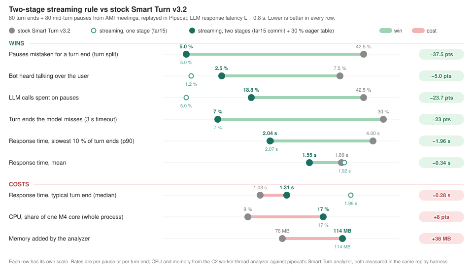
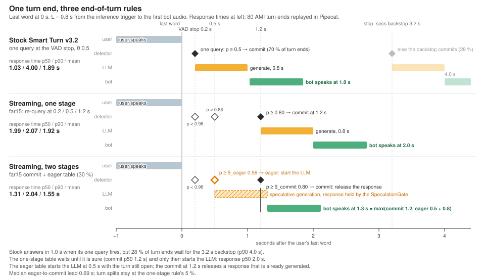
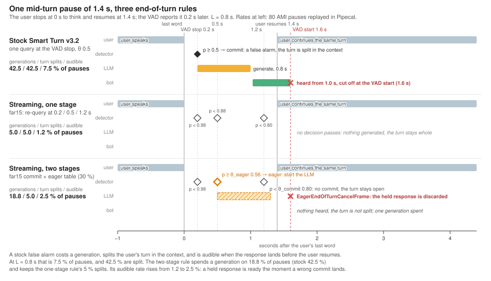
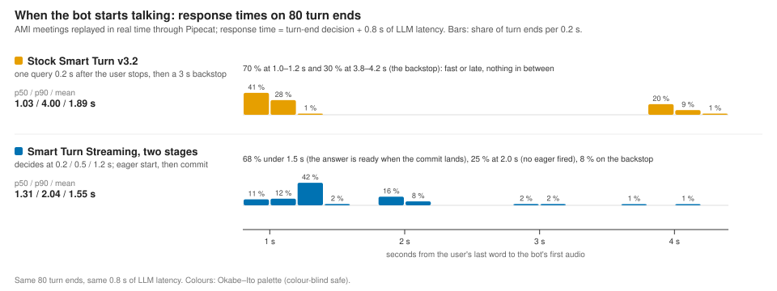

# smart-turn-streaming

Silence-aware, streaming end-of-turn detection for voice agents, built on Pipecat's frozen
[Smart Turn v3.2](https://huggingface.co/pipecat-ai/smart-turn-v3) encoder. CPU only, numpy and
onnxruntime, 32 MB of model files. Models on the Hub: [OpenHRI/smart-turn-streaming](https://huggingface.co/OpenHRI/smart-turn-streaming).

Stock Smart Turn asks its model once, 0.2 s after the user stops, and otherwise waits out a 3 s
timeout. On real conversation that one query fires on 42 % of mid-turn pauses and still leaves a
quarter of real turn ends to the timeout. This detector scores the conversation every 100 ms, decides
at 0.2 / 0.5 / 1.2 s of silence with thresholds fitted to a false-alarm budget, and drives Pipecat's
speculation path with a second, looser table so the LLM starts generating before the turn is committed.

## What changes against stock Smart Turn



Measured end to end in Pipecat 1.14 on 80 turn ends and 80 mid-turn pauses from the AMI Meeting
Corpus, replayed in real time through Silero VAD and `UserTurnProcessor`, with 0.8 s of LLM response
latency. Each row has its own scale.

## How a turn end and a pause play out





The two-stage rule on one set of decision points:

```
eager    p_end(τ) ≥ θ_eager(τ)    start the LLM (UserTurnSpeculation; the response is held by Pipecat's SpeculationGate)
commit   p_end(τ) ≥ θ_commit(τ)   end the turn and release the held response
cancel   the VAD reports speech   EagerEndOfTurnCancelFrame; the held response is discarded
```

θ_commit is fitted to a budget of turn splits (false ends of turn on pauses), θ_eager to a budget of
LLM generations spent on pauses. With a response latency L the user hears the bot at
`max(t_commit, t_eager + L)` instead of `t_commit + L`.

## Install

```bash
pip install "smart-turn-streaming[pipecat] @ git+https://github.com/OpenHRIai/smart-turn-streaming"
```

The model files download from the Hub on first use:

```python
from eot.hub import model_paths
encoder_onnx, heads_onnx = model_paths()      # ~32 MB, cached by huggingface_hub
```

## Use in Pipecat

```python
from eot.hub import model_paths
from eot.pipecat_analyzer import StreamingEOTAnalyzer, StreamingEOTParams
from eot.pipecat_eager_strategy import TurnAnalyzerEagerUserTurnStopStrategy
from pipecat.turns.user_start import VADUserTurnStartStrategy
from pipecat.turns.user_turn_strategies import UserTurnStrategies

encoder_onnx, heads_onnx = model_paths()
analyzer = StreamingEOTAnalyzer(
    encoder_onnx=encoder_onnx,
    heads_onnx=heads_onnx,
    params=StreamingEOTParams.from_rule("far15", eager="far15_gen30"),   # commit table + eager table
)
strategies = UserTurnStrategies(
    start=[VADUserTurnStartStrategy()],
    stop=[TurnAnalyzerEagerUserTurnStopStrategy(turn_analyzer=analyzer)],
)
```

`StreamingEOTParams.from_rule("far10")` without an eager table gives the one-stage rule, which also
works with Pipecat's own `TurnAnalyzerUserTurnStopStrategy`. The analyzer needs 16 kHz audio and the
VAD's default `stop_secs` of 0.2 s. Rule tables: `far5 | far10 | far15` (false-alarm budget on pauses)
and `far10_gen20|30|40`, `far15_gen20|30|40` (generation budget on pauses).

## Standalone streaming

```python
from eot.streaming import StreamingEOT

eot = StreamingEOT(encoder_onnx, heads_onnx, worker=True)
for frame, is_speech in audio_frames():        # 20 ms float32 frames in [-1, 1] and the VAD's verdict
    out = eot.push(frame, is_speech)          # None, or {"p_end", "p_eager", "tau", ...} at a 100 ms hop
    if out and not out["speaking"] and out["tau"] >= 1.2 and out["p_end"] >= 0.80:
        ...                                    # the far15 table's 1.2 s commit
```

## How it works

| path | when | work | cost (Apple M4, 1 ORT thread) |
|---|---|---|---|
| mel | every 20 ms frame | incremental Whisper log-mel, one 10 ms column at a time | 0.02 ms |
| heads | every 100 ms and at each silence-clock point | last 1 s of mel → GRU, cached pooled vector, silence length → P(complete) | 0.7 ms |
| encoder | every 320 ms during speech; at 0, 0.2, 0.5, 0.8, 1.2, 1.8, 2.5 s of silence | 8 s window → Whisper-tiny → pooled vector, on a worker thread | 22 ms |

The heads were trained on windows ending 0 to 2.5 s after the end of speech (pipecat's
`smart-turn-data-v3.2`, padded with each clip's own room tone) plus 43k real conversational pauses
from AMI. The GRU over the last second of mel is what carries the silence awareness. Details and
every measurement: [docs/results_so_far.md](docs/results_so_far.md) and the stage documents it links.

## Results in brief

AMI test, offline (511 turn ends, 4,304 pauses), reproduced by `release/eval/ami_eval.py` from the
public corpus:

| τ of silence | AUC, these heads | AUC, frozen Smart Turn v3.2 |
|---|---|---|
| 0.2 s | 0.775 | 0.671 |
| 1.2 s | 0.742 | 0.575 |

Pipecat, end to end, 80 + 80 AMI silences, L = 0.8 s:

| rule | turn splits | LLM calls on pauses | audible talk-over | response time p50 / p90 / mean |
|---|---|---|---|---|
| stock Smart Turn v3.2 | 42.5 % | 42.5 % | 7.5 % | 1.03 / 4.00 / 1.89 s |
| streaming, one stage (`far15`) | 5.0 % | 5.0 % | 1.2 % | 1.99 / 2.07 / 1.92 s |
| streaming, two stages (`far15` + `far15_gen30`) | 5.0 % | 18.8 % | 2.5 % | 1.31 / 2.04 / 1.55 s |

On pipecat's own `smart-turn-data-v3.2` test set the heads match the frozen model (AUC 0.976 vs 0.976
at the acoustic offset) and improve on it after silence (0.965 vs 0.955 at 2.5 s). On pipecat's official
`benchmark.py` (full test set, 31,527 clips, threshold 0.5) the calibrated clip-end graph scores 93.2 %
accuracy against Smart Turn v3.2's 93.7 %, same ranking and per-language pattern; that benchmark has no
pauses, so it is the regression guard, not the result ([docs/c3_benchmark.md](docs/c3_benchmark.md)).

Where the time goes, stock against the two-stage rule, on the same 80 turn ends:



## Limitations

- **Conversational evaluation is English-only.** The silence-aware behaviour was trained and measured
  on English meetings (AMI); the per-language check covers 23 languages but only on isolated
  utterances (`smart-turn-data`), where the heads stay within noise of the frozen model in every
  language and hold the decision through silence after an unfinished utterance in all 23 (false alarms
  after 2.5 s of silence 9.4 % against the frozen model's 22.5 % at a matched 5 % at the clip end).
  Whether the pause thresholds transfer to other languages' conversational timing, a pause that
  resumes, is not measured.
- Meetings set a ceiling: ending every turn at 1.2 s of silence gives recall 1.0 at 18 % false
  alarms, and below that budget about a quarter of turn ends wait for the backstop, for every model.
- Long pauses (≥ 1.5 s) remain the weak spot: 50–60 % false alarms at the 10–15 % budgets.
- The second output `p_eager` is not usable as a free-running trigger during speech (about 22 false
  fires per minute); the eager tables use P(complete) at the silence-clock points instead.
- The transcript-match withdrawal rate of the eager stage (an interim transcript that differs from the
  final one discards the held response) was not measured; the replay harness has no STT.

## Repository layout

| | |
|---|---|
| `eot/streaming.py` | incremental mel, two-cadence detector, worker-thread refresh |
| `eot/pipecat_analyzer.py` | the Pipecat `BaseTurnAnalyzer` with the commit and eager tables |
| `eot/pipecat_eager_strategy.py` | `TurnAnalyzerEagerUserTurnStopStrategy`, the speculation-path stop strategy |
| `eot/hub.py` | model download |
| `eot/{windows,turn_rules,ami,features,model,rules_eval}.py` | data windows, end-of-turn labelling rules, AMI reader, pooled-vector export, heads, rule fitting |
| `scripts/` | the experiment ladder: AMI build (`a2_*`), items and training (`b1_*`), fidelity and cost (`b2_validate.py`), Pipecat replay (`b3_replay.py`), eager sweep (`c1_eager_sweep.py`), calibration, fused clip-end export and pipecat's official benchmark (`c3_*`, `vendor/pipecat_benchmark.py`) |
| `release/` | Hub model card, rule tables, the self-contained AMI evaluation script and manifests, `stage.py` |
| `docs/` | plan, results and one document per stage; `docs/figures/` the figures above |
| `tests/` | 40 tests (`pip install -e ".[pipecat,dev]" && pytest -q`) |
| `UPSTREAM.md` | the pinned Smart Turn encoder and how to move to a new one |

## Licence and attribution

BSD 2-Clause (`LICENSE`). The encoder is Pipecat's Smart Turn v3.2 (Daily, BSD 2-Clause), weights
unchanged. The AMI Meeting Corpus is CC BY 4.0; the manifests under `release/eval/` derive from its
annotations and ship with `release/AMI_LICENCE.txt`. Sources and citations: `release/ATTRIBUTION.md`.
